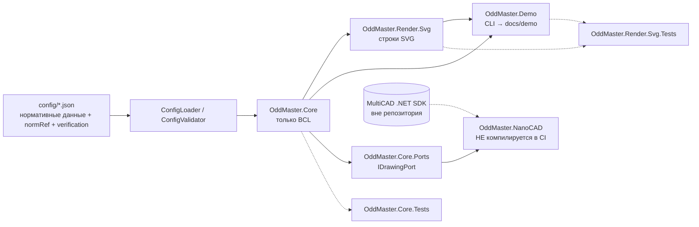
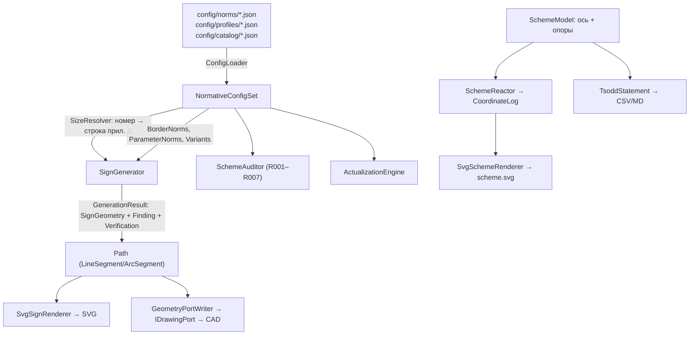

# Архитектура «ОДД-Мастер»

Каркас ночного прогона №1. Главная идея: нормативные данные и алгоритмы отделены от САПР. Всё, что можно проверить на Linux, проверяется на Linux; всё, что требует nanoCAD, вынесено в отдельный некомпилируемый адаптер.

## Слои и правило зависимостей

Правило: стрелка — «зависит от». Зависимости идут только вниз/вправо; из `OddMaster.Core` нет ссылок на `Multicad*`, `Teigha*`, `Avalonia*`, `System.Windows*`, WPF/WinForms или `OddMaster.Render.*`. Это проверяет тест `M2-G13` и `M9-A01`.

| Проект | TFM | Зависимости | Что делает |
|---|---|---|---|
| `OddMaster.Core` | `$(OddTargetFramework)` | только BCL | нормы, каталог, геометрия, генератор, ось, ведомость, контроль, Актуализатор, порты |
| `OddMaster.Render.Svg` | `$(OddTargetFramework)` | Core | детерминированный SVG знаков и схемы |
| `OddMaster.Demo` | `$(OddTargetFramework)` | Core, Render.Svg | CLI `signs/scheme/check/actualize/all`, пишет `docs/demo/` |
| `OddMaster.Core.Tests` | `$(OddTargetFramework)` | Core | 87 тестов |
| `OddMaster.Render.Svg.Tests` | `$(OddTargetFramework)` | Core, Render.Svg, Demo | 19 тестов |
| `OddMaster.NanoCAD` | `net8.0-windows` | Core + SDK (вне git) | скелет адаптера, **не собирается** |

## Поток данных

Ключевое: `SignGeometry` — это данные (контуры, слои, надписи, статусы проверки), а не объект чертежа. Один и тот же объект идёт в SVG, в будущую таблицу на чертеже и в примитивы САПР.

## Нормативные данные

- Источник истины — `config/` : 10 нормативных файлов + 9 JSON Schema (draft-07).
- Каждый файл содержит `normRef` (документ, пункт, таблица/рисунок) и `verification` (`Placeholder`, `Unverified`, `CuratorExtracted`, `StudentVerified`).
- Неизвестное значение = `null` + `GOST-NNN` в `docs/VERIFICATION_QUEUE.md`. `StudentVerified` ставит только человек.
- Всё, где участвует `Placeholder`/`Unverified`, получает `IsDraft = true` и баннер «ЧЕРНОВИК».
- В коде нет чисел из ГОСТ: размеры, каймы, допуски, параметры, коридор, условные размеры схемы — из конфигов.

Семантика номеров (`SignNumber`): кортеж чисел; `3.2 < 3.10 < 3.24`; диапазон «6.14.2 - 6.16» не включает 6.16.1; одиночный «6.2» не совпадает с 6.2.1. Подробнее — ADR-0005.

## Точки расширения

| Точка | Как расширять |
|---|---|
| Новый знак | добавить запись в `config/catalog/signs.poc.json` по `signTemplate`; при необходимости строку в профиль прил. Д |
| Новый стандарт/профиль | новый файл в `config/profiles/`, регистрация в `ConfigPaths`, схема уже есть |
| Новое правило контроля | новая запись R00N в `config/rules/controls.json` + метод в `SchemeAuditor` |
| Новая карта замен | заполнить `config/actualizer/map-2004-2024.json` (сейчас пустая) |
| Новый рендер | реализовать `IDrawingPort` или написать ещё один writer поверх `SignGeometry` |
| Новый формат ведомости | новый метод `ToXxx()` в `TsoddStatement`, форма колонок в конфиге (сейчас GOST-011) |
| Кривые в плане | заменить полилинию в `Alignment` на сегменты «прямая/дуга/клотойда»; интерфейс `PointAt/Project` сохраняется |

## Детерминизм

- Никаких `DateTime.Now`, `Guid.NewGuid()`, `Random` без фиксированного seed (seed 20261027 в M4-A14).
- Все числа форматируются `CultureInfo.InvariantCulture`; для CSV точка заменяется на запятую только на границе вывода.
- Порядок обхода коллекций устойчив: явные `OrderBy(StringComparer.Ordinal)`, `SignNumber` implements `IComparable`.
- Проверка: `scripts/verify.sh` повторно генерирует `docs/demo/` и требует `git diff --exit-code`.

## Кольца и порты (программа «LINUX-ПОЛИГОН», задел под F1)

Четыре кольца: ядро → порты → Linux-эмулятор САПР → nanoCAD-хост. Сегодня существует только кольцо 0
и два порта вывода; остальные — контракт на следующую фазу, кода нет.

| Порт | Ответственность | Статус |
|---|---|---|
| `IDrawingPort` | Примитивы: линия, дуга, залитый контур, текст с высотой прописных | **есть** (`Core/Ports`, ADR-0025) |
| `ICadBackend` | Документ: слои, сохранение, знак целиком | **есть** (реализация — `OddMaster.Render.Dxf`) |
| `ICadDocument` + `ICadTransaction` | Создать/найти/изменить/удалить по непрозрачному дескриптору, транзакции, группы отмены | **есть** (F1, ADR-0032), реализован эмулятором |
| `ICadEvents` | «Изменён/удалён/отмена/повтор» + отложенная очередь пересчёта | **есть** (F1): слияние событий, запрет повторного входа |
| `ICadInteraction` | Ввод для доменных команд; в тестах — сценарий ввода | **есть** (F1): точка, объект, выбор из списка |
| `ICadGrips` | Ручки доменных объектов; геометрию ручек решает ядро | план F2 |
| `ICadPersistence` | Версионированные свойства объектов, миграции, кэш графики | **есть** (F1): JSON v2, миграция v1→v2, режим «модуль не загружен» |
| `ICadImport` | Чтение старых чертежей (DXF на Linux, DWG в nanoCAD) | план F4 |

Хосты: `OddMaster.Host.Emulator` (строгий эмулятор в памяти, кольцо 2) реализует все порты выше;
`OddMaster.NanoCAD` (кольцо 3) — заготовка без кода до появления `sdk/`. Контрактные кейсы лежат
в `OddMaster.Contracts` и не зависят от xUnit: их исполняют и xUnit на Linux/Windows, и `ODD_SELFTEST`
внутри nanoCAD.

Правила зависимостей (проверяются архитектурным тестом, M2-G13 уже запрещает CAD-API в ядре):
ядро не ссылается на хосты; в ядре нет `OperatingSystem.*`, `RuntimeInformation.*`, `#if WINDOWS`;
адаптер nanoCAD ссылается только на ядро и SDK; ViewModel — в ядре, View — тонкая и только в кольце 3.

## Чего здесь нет

YAGNI: нет DI-контейнера, MediatR, event sourcing, ORM, плагинного фреймворка, UI. Будущий UI — Avalonia (ADR-0008). SQLite возможен как кэш, но сейчас JSON в git — источник истины (ADR-0001).
